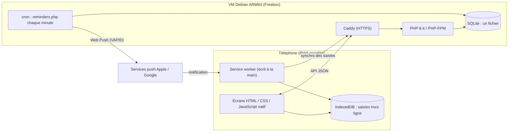

# Cahier des charges — Application de suivi sportif

Nov 25, 2026 · @Bruno · révision 4 (voir « Journal des décisions »)

## Contexte et objectifs

L'application sert à un seul utilisateur, un homme de 47 ans, à tenir un programme de 3 séances de 30 min par semaine pour perdre du ventre et renforcer la sangle abdominale. Elle doit guider chaque séance, montrer les mouvements, suivre l'apport en protéines et envoyer les rappels au bon moment.

Pratique actuelle à intégrer : environ 230 pompes par jour, en 10 séries réparties sur la journée. L'app en fait une routine quotidienne de 10 séries de X pompes (X réglé par l'utilisateur), avec objectifs, encouragements et 3 jokers par mois.

**Objectifs de l'application**

- Faire tenir le rythme de 3 séances par semaine (lundi, mercredi, vendredi par défaut, jours réglables).
- Guider chaque séance pas à pas : exercice, visuel, répétitions, temps de repos.
- Suivre la progression : charges, répétitions, tours réalisés, poids et tour de taille.
- Calculer le besoin quotidien en protéines et suivre ce qui est consommé.
- Tenir la routine quotidienne de pompes : 10 séries de X, série de jours, 3 jokers par mois, encouragements.
- Rappeler les séances, les séries de pompes et l'objectif protéines.

**Matériel disponible**

| Matériel | Détail | Usage dans le programme |
| --- | --- | --- |
| Kettlebells | 10 kg et 12 kg | Swings, squat gobelet, rowing, marche du fermier |
| Haltères / poids | 2 × 5 kg | Fentes, rotations russes |
| Banc de musculation | avec barre de 3 à 50 kg | Rowing barre, soulevé de terre jambes tendues, développé couché, relevés de jambes, crunchs |
| Tapis de course | inclinable | Échauffement, fractionné en marche inclinée |

**Indicateurs de réussite suivis par l'app**

- Taux de séances réalisées sur les séances prévues, par semaine et par mois.
- Nombre de jours où l'objectif protéines est atteint, par semaine.
- Évolution du tour de taille (mesure mensuelle) et du poids (pesée hebdomadaire).
- Nombre de pompes par jour, jours atteints par mois, série de jours en cours et record, jokers utilisés.

## Périmètre

La V1 couvre tout le nécessaire pour suivre le programme au quotidien. La V2 ajoute le confort et l'analyse.

| Fonction | V1 | V2 |
| --- | --- | --- |
| Programme A / B / C préchargé et jours de séance réglables | Oui | — |
| Mode séance guidé (chrono, répétitions, repos, saisie des charges) | Oui | — |
| Fiches exercices avec visuel et consignes | Oui (images) | Vidéos courtes en boucle |
| Pompes quotidiennes : 10 séries de X, objectifs, encouragements, 3 jokers par mois | Oui | — |
| Calcul du besoin en protéines et suivi journalier | Oui | Scan de code-barres |
| Rappels par notification (séances, pompes, protéines, pesée) | Oui | Rappels adaptatifs (décalage si séance manquée) |
| Historique et courbes (poids, tour de taille, charges) | Historique simple | Courbes et records personnels |
| Progression automatique (suggestion de charge ou de répétitions) | Règles fixes par phase | Suggestion selon les séances passées |
| Export des données (CSV) | — | Oui |

**Hors périmètre**

- Multi-utilisateurs, partage, social.
- Synchronisation avec Apple Santé, Google Fit ou une montre.
- Plan alimentaire complet ou comptage des calories : seules les protéines sont suivies.
- Conseil médical : l'app affiche un rappel de consulter un médecin avant le fractionné, sans plus.

## Fonctionnalités

Le cœur de l'app est le mode séance : il déroule le programme exercice par exercice et enregistre ce qui a été fait, sans saisie au clavier pendant l'effort.

### F1 — Programme préchargé

Le programme est livré en données (`data/program.json`, chargé par le seed) ; on le modifie en éditant ce fichier, sans écran d'administration en V1.

| Séance | Bloc | Exercice | Charge de départ | Volume |
| --- | --- | --- | --- | --- |
| A — Force + abdos | Échauffement | Marche rapide sur tapis, mobilité, squats à vide | — | 5 min |
| A | Circuit force (3 tours, 1 min de repos entre tours) | Squat gobelet | Kettlebell 12 kg | 12 rép. |
| A | Circuit force | Rowing barre penché | Barre, charge à régler | 10 rép. |
| A | Circuit force | Soulevé de terre jambes tendues | Barre, charge à régler | 10 rép. |
| A | Circuit force | Fentes arrière | 2 × 5 kg | 8 par jambe |
| A | Abdos (3 tours) | Relevés de jambes sur banc | — | 12 rép. |
| A | Abdos | Planche avant-bras | — | 40 s |
| A | Abdos | Rotations russes | 5 kg | 20 au total |
| B — Cardio + gainage | Échauffement | Marche, mobilité | — | 5 min |
| B | Swings (6 séries, 45 s de repos) | Kettlebell swing | 10 kg semaines 1-2, puis 12 kg | 15 rép. |
| B | Fractionné | Marche rapide inclinée (10 à 15 %) / marche lente | — | 8 × (45 s + 45 s) |
| B | Abdos (2 tours) | Marche du fermier unilatérale | Kettlebell 12 kg | 30 s par côté |
| B | Abdos | Dead bug | — | 10 par côté |
| B | Abdos | Hollow hold | — | 20 à 30 s |
| C — Full body | Échauffement | Marche, mobilité | — | 5 min |
| C | Circuit AMRAP 20 min (max de tours) | Kettlebell swing | 12 kg | 10 rép. |
| C | Circuit AMRAP | Squat gobelet | 12 kg | 10 rép. |
| C | Circuit AMRAP | Développé couché barre | Charge légère | 8 rép. |
| C | Circuit AMRAP | Rowing kettlebell sur banc | 10 kg | 10 par bras |
| C | Circuit AMRAP | Crunch sur banc | — | 10 rép. |
| C | Circuit AMRAP | Mountain climbers | — | 30 s |
| C | Retour au calme | Marche, étirements hanches et dos | — | 5 min |

### F2 — Mode séance guidé

- Écran plein, gros boutons utilisables d'une main, écran maintenu allumé (Screen Wake Lock API). Sur iPhone, le maintien de l'écran allumé dans une app installée n'est fiable qu'à partir d'iOS 18.4 : prérequis à vérifier sur le téléphone dès le lot 2.
- Pour chaque exercice : visuel, nom, consignes clés, objectif (répétitions ou durée, valeur unique ou fourchette, ex. « 20 à 30 s »), charge préremplie avec celle de la dernière séance.
- Première séance : les charges notées « à régler » ou « légère » sont demandées au début de l'exercice, puis reprises aux séances suivantes.
- Enchaînement dans un circuit : 15 s de transition entre deux exercices (réglable), sauf en AMRAP où l'enchaînement est libre.
- Exercices en durée : compte à rebours avec bip à 3 s de la fin, plus vibration sur Android. iOS ne gère pas la vibration web : sur iPhone, le signal passe par le son et un flash de l'écran.
- Le son est débloqué par le tap sur « Démarrer » (obligation iOS) ; l'écran de démarrage rappelle que le bouton silencieux de l'iPhone coupe les bips.
- Exercices en répétitions : bouton « Fait », puis répétitions réalisées modifiables par +/−.
- Repos : minuteur automatique avec aperçu de l'exercice suivant, bouton « Passer ».
- Circuit AMRAP : chrono global de 20 min et compteur de tours.
- Fractionné : pente fixe réglée au début (10 à 15 %), seule la vitesse alterne (vitesses rapide et lente réglables, ex. 5,5 et 3,5 km/h). Chaque changement est annoncé par un son, une couleur d'écran et un libellé « RAPIDE » / « LENTE » (pas d'information par la couleur seule).
- Fin de séance : résumé (durée, tours, charges), ressenti sur 5 (facile → épuisant), note libre, signalement d'une douleur.
- Séance interrompue : reprise possible au même exercice pendant 12 h.

### F3 — Pompes quotidiennes

Les pompes se font **tous les jours**, jours de séance compris : **10 séries de X pompes**, réparties sur la journée. X est choisi par l'utilisateur à l'onboarding (23 par défaut, soit la pratique actuelle de 230 par jour) et modifiable dans les réglages.

**Saisie**

- Bouton « +X » (une série) sur l'accueil et dans la notification, plus saisie libre (série incomplète, pompes en plus). Dans tout le document, « +X » désigne ce bouton.
- Jauge du jour en séries (ex. « 6 / 10 séries ») et en pompes (« 138 / 230 »).
- Objectif du jour = nombre de séries × X. Le nombre de séries reste réglable (10 par défaut).
- « Journée allégée » activée par défaut les jours de séance : 5 séries au lieu de 10 (réglable et désactivable), les séances sollicitant déjà épaules et pectoraux (développé couché, planche, mountain climbers). Une journée allégée réussie compte comme une journée atteinte.
- Signalement d'une douleur épaule ou coude : propose de réduire l'objectif pendant 3 jours (enregistré dans `pain_report`). Ces journées réduites comptent comme atteintes si l'objectif réduit est fait.

**Objectifs**

| Objectif | Règle | Affichage |
| --- | --- | --- |
| Du jour | Toutes les séries du jour faites (10 × X, ou objectif allégé ou réduit) | Jauge sur l'accueil |
| Série de jours | Nombre de jours consécutifs atteints ou couverts par un joker | « 12 jours d'affilée » sur l'accueil |
| Paliers de série | 7, 14, 30, 60, 100, 200 et 365 jours | Message de félicitations et palier affiché dans le Suivi |
| Du mois | Jours atteints sur les jours écoulés du mois | « 18 / 20 jours » dans le Suivi |
| Record | Plus longue série de jours, plus grand total sur une journée | Suivi |
| Progression de X | Après 14 jours consécutifs atteints sans joker ni douleur, l'app propose X + 1 ; l'utilisateur accepte ou refuse, et l'app ne repropose pas avant 14 jours | Proposition sur l'accueil |

- X ne diminue jamais automatiquement ; l'utilisateur peut le baisser à tout moment, sans perdre sa série de jours.
- Chaque journée garde l'objectif qui s'appliquait ce jour-là : changer X ne modifie pas l'historique.

**Jokers**

- 3 jokers par mois civil, remis à 3 le 1ᵉʳ du mois ; les jokers non utilisés ne se reportent pas.
- Un joker couvre une journée dont l'objectif n'est pas atteint : la série de jours n'est pas cassée. La journée est marquée « joker » dans l'historique, pas « atteinte ».
- Utilisation manuelle : bouton « Poser un joker » sur l'accueil, pour aujourd'hui ou hier (rattrapage d'un oubli).
- Utilisation automatique (activée par défaut, désactivable) : à minuit, une journée non atteinte consomme un joker s'il en reste ; un message le signale à la première ouverture du lendemain.
- Sans joker restant, une journée non atteinte casse la série de jours, qui repart à 0 le lendemain. Le record reste affiché.
- Jokers restants visibles sur l'accueil (« 2 jokers ce mois-ci »).

**Encouragements**

Messages courts, en français, tirés d'un fichier `data/encouragements.json` modifiable sans toucher au code, et jamais le même deux fois de suite.

| Moment | Exemple |
| --- | --- |
| Après une série | « 4 / 10. Une de plus que tout à l'heure. » |
| Mi-parcours (5ᵉ série) | « La moitié est faite. » |
| Dernière série restante | « Plus qu'une série pour boucler la journée. » |
| Objectif du jour atteint | « 230 pompes aujourd'hui. Journée bouclée. » |
| Palier de série | « 30 jours d'affilée. C'est devenu une habitude. » |
| Retard sur la journée (rappel du soir) | « Encore 3 séries, il reste 2 h avant la plage silencieuse. » |
| Joker consommé | « Joker utilisé hier : la série continue, 2 jokers restants. » |
| Série cassée | « Série terminée à 21 jours, ton record. On repart aujourd'hui. » |
| Nouveau record | « Nouveau record : 45 jours d'affilée. » |

- Ton neutre et positif : pas de culpabilisation après un échec.
- Messages affichés dans l'app (bandeau après la saisie) et repris dans le texte des notifications de pompes.

### F4 — Progression

Règles appliquées par l'app, adaptées à un démarrage à 47 ans. Les semaines comptées sont des **semaines actives** (au moins 2 séances réalisées) : une pause ne fait pas avancer la phase.

1. Semaines actives 1 à 3 : apprentissage, charges et volumes de départ. Seule augmentation prévue : swings à 12 kg à partir de la semaine active 3.
2. Semaines actives 4 et 5 : +1 tour au circuit A, ou +2 répétitions par exercice (l'app propose le tour en premier).
3. À partir de la semaine active 6, une augmentation par semaine, dans cet ordre : charge supérieure sur la barre (+2,5 kg), puis rowing kettlebell à 12 kg, puis repos réduits de 15 s. Le cycle reprend ensuite par la barre.

- Une seule variable augmentée à la fois ; l'app propose, l'utilisateur valide. La charge validée est enregistrée pour l'utilisateur (`user_item_load`) sans modifier le programme.
- Si le ressenti est « épuisant » ou qu'une douleur est signalée, pas d'augmentation à la séance suivante.
- Reprise après 14 jours sans séance : l'app propose de revenir aux charges d'il y a deux semaines actives.

**Planification des séances**

- Les séances tournent dans l'ordre A → B → C, quel que soit le jour. Une séance manquée n'est pas perdue : la suivante reprend là où la rotation s'est arrêtée (lundi A manqué → mercredi A).
- Deux séances ne sont jamais planifiées deux jours de suite.
- « Reporter à demain » n'est proposé que si ni la veille ni le surlendemain du report ne sont des jours de séance (avec lundi, mercredi, vendredi : seul le vendredi peut être reporté au samedi). Sinon, l'app indique que la séance passe au prochain jour prévu.
- Le compteur de la semaine affiche x / nombre de jours de séance réglés (3 par défaut).

### F5 — Mesures et historique

- Pesée hebdomadaire et tour de taille mensuel (au nombril, debout, après expiration : consigne affichée).
- Historique des séances : date, séance, durée, charges et répétitions par exercice.
- Accueil : séance du jour, pompes du jour, protéines du jour, séances réalisées cette semaine (x / jours prévus).

## Démonstration des mouvements

Chaque exercice a une fiche : un visuel en deux temps (position de départ, position d'arrivée) et 3 consignes clés. La fiche s'ouvre depuis le mode séance et depuis la bibliothèque d'exercices.

**Contenu d'une fiche**

- Nom français de l'exercice et nom anglais (pour la correspondance avec la base d'images).
- Visuel : 2 images alternées automatiquement toutes les 1,5 s pour simuler le mouvement (V1), vidéo courte en boucle sans son (V2).
- Muscles travaillés (texte simple).
- 3 consignes clés, 1 erreur fréquente à éviter.
- Variante plus facile, proposée si une douleur est signalée.

**Où et comment trouver les visuels**

Pour chaque exercice, on cherche dans cet ordre : free-exercise-db, puis wger, puis on filme soi-même. Les visuels retenus sont copiés sur le serveur : l'app n'appelle aucun site externe en production.

1. **free-exercise-db (à essayer en premier)**
   - Parcourir le catalogue sur [yuhonas.github.io/free-exercise-db](https://yuhonas.github.io/free-exercise-db/) : recherche par nom anglais, filtre par matériel.
   - Données : un fichier JSON par exercice dans `exercises/`, ou tout en un dans `dist/exercises.json` ([dépôt GitHub](https://github.com/yuhonas/free-exercise-db)).
   - Images : JPG numérotées à partir de 0 dans `exercises/<id>/` ; en général `0.jpg` = position de départ, `1.jpg` = position d'arrivée. URL directe : `https://raw.githubusercontent.com/yuhonas/free-exercise-db/main/exercises/<id>/0.jpg`.
   - Licence : Unlicense (domaine public). Lire l'[issue n° 12](https://github.com/yuhonas/free-exercise-db/issues/12) sur le statut des images avant de rendre l'app publique.
2. **wger (si l'exercice manque ou est mal illustré)**
   - Base d'exercices collaborative sur [wger.de](https://wger.de/), avec API REST ([documentation](https://wger.readthedocs.io/)).
   - Images sous licence Creative Commons CC-BY-SA, par exercice : l'auteur et la licence doivent être affichés sur la fiche (champ `attribution`).
3. **Visuels filmés soi-même (exercices introuvables ou propres au matériel)**
   - Téléphone posé au sol, de profil, corps entier dans le cadre, fond neutre.
   - 2 photos (départ, arrivée) pour la V1 ; vidéo de 5 à 10 s sans son pour la V2.
   - Fichiers déposés dans `public/media/` et déclarés dans `data/exercise_media.json`.

**Intégration dans l'app**

- Un fichier de correspondance `data/exercise_media.json` associe chaque exercice à sa source (id free-exercise-db, id wger ou fichier local).
- Un script `php bin/media-import.php` télécharge les images listées, les convertit en WebP (100 Ko maximum) et remplit `media_paths`, `source`, `license` et `attribution`.
- Le statut ci-dessous se tient à jour pendant la recherche.

| Exercice | Termes à chercher (anglais) | Source à essayer en premier | Statut |
| --- | --- | --- | --- |
| Squat gobelet | goblet squat | free-exercise-db | À vérifier |
| Rowing barre penché | bent over barbell row | free-exercise-db | À vérifier |
| Soulevé de terre jambes tendues | stiff-legged deadlift, romanian deadlift | free-exercise-db | À vérifier |
| Fentes arrière | rear lunge, reverse lunge | free-exercise-db | À vérifier |
| Relevés de jambes sur banc | flat bench leg raise, lying leg raise | free-exercise-db | À vérifier |
| Planche avant-bras | plank | free-exercise-db | À vérifier |
| Rotations russes | russian twist | free-exercise-db | À vérifier |
| Kettlebell swing | kettlebell swing | free-exercise-db | À vérifier |
| Marche du fermier unilatérale | suitcase carry, farmer's walk | wger | À vérifier |
| Dead bug | dead bug | wger | À vérifier |
| Hollow hold | hollow hold, hollow body | wger | À vérifier |
| Développé couché barre | barbell bench press | free-exercise-db | À vérifier |
| Rowing kettlebell sur banc | one arm kettlebell row, one arm dumbbell row | free-exercise-db | À vérifier |
| Crunch sur banc | crunch, decline crunch | free-exercise-db | À vérifier |
| Mountain climbers | mountain climbers | free-exercise-db | À vérifier |
| Marche inclinée (tapis) | — | Filmé soi-même | À filmer |
| Mobilité (échauffement) | arm circles, hip circles, cat cow | wger, sinon filmé soi-même | À vérifier |
| Squat à vide | bodyweight squat | free-exercise-db | À vérifier |
| Étirements hanches et dos (retour au calme) | hip flexor stretch, child's pose, cat stretch | free-exercise-db | À vérifier |
| Squat sur le banc (variante) | box squat, bench squat | free-exercise-db, sinon filmé soi-même | À vérifier |

Les échauffements, retours au calme et variantes plus faciles ont aussi une fiche : le critère de recette « chaque exercice du programme a une fiche » les inclut. Les variantes qui ne sont qu'un réglage d'un exercice existant (sans poids, amplitude réduite, kettlebell 10 kg) réutilisent la fiche de cet exercice avec un texte de variante, sans nouveau visuel.

Muscles travaillés : repris des champs `primaryMuscles` et `secondaryMuscles` de free-exercise-db, traduits en français à l'import ; saisis à la main pour les exercices hors free-exercise-db.

**Consignes à intégrer**

| Exercice | Consignes clés | Erreur à éviter | Variante plus facile |
| --- | --- | --- | --- |
| Squat gobelet | Kettlebell contre la poitrine ; pieds largeur d'épaules ; descendre hanches sous les genoux si possible | Talons qui décollent | Squat sans charge sur le banc (s'asseoir, se relever) |
| Rowing barre penché | Buste à 45°, dos plat ; tirer la barre vers le nombril ; serrer les omoplates | Dos arrondi | Rowing kettlebell un bras appuyé sur le banc |
| Soulevé de terre jambes tendues | Genoux légèrement fléchis ; la barre glisse le long des cuisses ; la hanche recule | Dos qui s'arrondit en bas | Amplitude réduite jusqu'aux genoux |
| Fentes arrière | Grand pas en arrière ; genou arrière vers le sol ; buste droit | Genou avant qui rentre vers l'intérieur | Sans poids, main sur un appui |
| Relevés de jambes sur banc | Mains qui tiennent le banc ; bas du dos plaqué ; descendre lentement | Dos qui se cambre | Jambes fléchies |
| Planche avant-bras | Coudes sous les épaules ; corps aligné ; ventre et fessiers serrés | Bassin qui s'affaisse | Sur les genoux |
| Rotations russes | Assis, buste incliné en arrière ; rotation des épaules, pas seulement des bras | Dos arrondi | Pieds au sol, sans poids |
| Kettlebell swing | Le mouvement part des hanches ; bras relâchés ; fessiers serrés en haut | Squatter au lieu de basculer les hanches | Kettlebell 10 kg, amplitude jusqu'au bassin |
| Marche du fermier unilatérale | Kettlebell d'un côté ; épaules à niveau ; buste vertical | Pencher vers la charge | Kettlebell 10 kg |
| Dead bug | Sur le dos, bras vers le plafond ; bras et jambe opposés descendent lentement ; bas du dos au sol | Dos qui décolle | Bouger seulement les jambes |
| Hollow hold | Bas du dos collé au sol ; bras et jambes tendus et décollés ; respirer | Dos qui se creuse | Genoux pliés, bras le long du corps |
| Développé couché barre | Pieds au sol ; omoplates serrées ; barre vers le bas des pectoraux | Fesses qui décollent du banc | Charge plus légère, amplitude contrôlée |
| Rowing kettlebell sur banc | Main et genou sur le banc ; dos plat ; coude qui remonte le long du corps | Rotation du buste | Kettlebell 10 kg |
| Crunch sur banc | Menton légèrement rentré ; enrouler le haut du dos ; souffler en montant | Tirer sur la nuque | Amplitude réduite |
| Mountain climbers | Position de pompe ; genoux vers la poitrine en alternance ; bassin bas | Fesses trop hautes | Rythme lent, pas à pas |
| Marche inclinée (tapis) | Ne pas se tenir aux barres ; grands pas ; respiration régulière | Se pendre aux poignées | Pente réduite |

## Protéines

L'app calcule l'objectif quotidien à partir du poids saisi et d'un coefficient par défaut de 1,5 g par kg et par jour, puis suit ce qui est mangé dans la journée.

**Calcul du besoin**

```latex
\text{Objectif (g/j)} = \text{poids (kg)} \times \text{coefficient (g/kg/j)}
```

| Paramètre | Valeur | Source |
| --- | --- | --- |
| Coefficient par défaut (sportif) | 1,5 g/kg/j | [La Revue du Praticien](https://www.larevuedupraticien.fr/exercice/sportifs-quel-apport-et-quelles-sources-de-proteines) |
| Repère minimum adulte en bonne santé (affiché à titre indicatif) | 0,83 g/kg/j | [Anses via sante.fr](https://www.sante.fr/node/6746931) |
| Borne haute du réglage | 2,0 g/kg/j | [OFSP, recommandations protéines](https://www.edi.admin.ch/dam/fr/sd-web/b0pN3MW7DOeC/empfehlung-proteine-ernaehrung-menschen-fr.pdf) |

- Le coefficient est réglable entre 0,83 et 2,0 g/kg/j.
- Le poids utilisé est la dernière pesée ; l'objectif se met à jour à chaque nouvelle pesée.
- Répartition affichée par repas : objectif divisé par le nombre de repas réglable (3 par défaut).
- Mention affichée dans l'écran : repère général, à ajuster avec un médecin ou un diététicien en cas de problème rénal ou de traitement.

**Suivi journalier**

- Saisie en 2 taps : choisir un aliment favori, choisir la portion.
- Teneurs en protéines issues de la [table Ciqual de l'Anses](https://ciqual.anses.fr/), importée en base : aucune teneur saisie à la main pour un aliment Ciqual (seule exception : l'aliment absent de Ciqual, ci-dessous).
- Favoris créés par l'utilisateur à partir de Ciqual, avec sa portion habituelle (ex. « 2 œufs », « 1 pot de fromage blanc »), quantité en grammes saisie par lui.
- Aliment absent de Ciqual : saisie d'un libellé et des grammes de protéines lus sur l'étiquette.
- Jauge du jour (consommé / objectif), reste à manger, historique sur 7 et 30 jours.
- Jour « atteint » quand la consommation dépasse 90 % de l'objectif.

## Rappels

Les rappels passent par des notifications Web Push envoyées par le serveur, ce qui les fait arriver même application fermée. Chaque type se règle et se désactive séparément.

| Rappel | Quand (par défaut, réglable) | Condition d'envoi | Action dans la notification |
| --- | --- | --- | --- |
| Séance du jour | Lundi, mercredi, vendredi à l'heure choisie | Séance pas encore commencée | Ouvrir la séance |
| Séance pas faite | 2 h après le premier rappel | Séance toujours pas faite | Ouvrir la séance / Reporter à demain (si le report est permis, voir F4) |
| Série de pompes | 10 créneaux répartis entre une heure de début et une heure de fin, tous les jours | Objectif du jour non atteint ; texte avec encouragement et séries restantes | Android : « +X » sans ouvrir l'app. iPhone : ouverture de l'écran pompes, « +X » en un tap |
| Protéines | En fin de journée, heure choisie | Moins de 70 % de l'objectif consommé | Ouvrir la saisie |
| Pesée | Une fois par semaine, jour et heure choisis | Pas de pesée depuis 7 jours | Ouvrir la saisie |
| Tour de taille | Une fois par mois | Pas de mesure depuis 30 jours | Ouvrir la saisie |

**Fonctionnement**

- Plage silencieuse réglable (aucune notification la nuit).
- Un seul rappel envoyé à la fois : si plusieurs tombent au même moment, ils sont regroupés.
- Les actions de notification (« +X », « Reporter ») sont traitées par le service worker, qui appelle l'API.
- Les heures des rappels sont calculées dans le fuseau de l'utilisateur (`user.timezone`), changements d'heure compris.

**Contraintes iPhone**

- Les notifications ne marchent que si l'app est ajoutée à l'écran d'accueil depuis le menu Partager, sur iOS ou iPadOS 16.4 minimum ([WebKit](https://webkit.org/blog/13878/web-push-for-web-apps-on-ios-and-ipados/)).
- La demande d'autorisation doit suivre un tap de l'utilisateur sur un bouton : écran « Activer les rappels » dans l'onboarding.
- iOS n'affiche pas les boutons d'action des notifications web : « +X » et « Reporter à demain » ne sont proposés comme boutons que sur Android. Sur iPhone, le tap sur la notification ouvre directement l'écran concerné (`/pompes?serie=1` avec un grand bouton « +X » déjà en place, ou l'aperçu de séance avec « Reporter à demain ») : l'action se fait en un tap après ouverture.
- Si l'utilisateur refuse, iOS ne repropose pas la demande ([OneSignal](https://documentation.onesignal.com/docs/web-push-for-ios)) : l'app affiche alors la marche à suivre dans les réglages iOS.
- Solution de secours : export des séances au format .ics pour les ajouter au calendrier du téléphone, avec alerte.

## Écrans et parcours utilisateur

L'app tient en 9 écrans, navigation par barre en bas (Accueil, Séances, Protéines, Suivi, Réglages).

| Écran | Contenu | Actions principales |
| --- | --- | --- |
| Onboarding | Poids, jours et heure des séances, nombre X de pompes par série, plage des pompes, ajout à l'écran d'accueil, activation des rappels | Valider, activer les notifications |
| Accueil | Séance du jour ou prochain jour de séance, jauge pompes (séries et total), série de jours, jokers restants, jauge protéines, séances de la semaine (x / jours prévus), encouragement du moment | Démarrer la séance, +X pompes, poser un joker, accepter X + 1, ajouter des protéines |
| Aperçu de séance | Liste des exercices de la séance, durée prévue, charges prévues | Démarrer, consulter une fiche |
| Mode séance | Visuel, consignes, objectif, chrono, repos, exercice suivant | Fait, +/−, passer, pause, arrêter |
| Fin de séance | Résumé, ressenti, douleur, note | Enregistrer |
| Bibliothèque d'exercices | Fiches de tous les exercices | Ouvrir une fiche |
| Protéines | Jauge du jour, favoris, journal du jour | Ajouter, modifier, supprimer une entrée |
| Suivi | Historique des séances, poids, tour de taille, pompes (calendrier atteint / joker / manqué, jours du mois, paliers, records), protéines atteintes | Saisir une mesure, filtrer par période |
| Réglages | Jours et heures, rappels, coefficient protéines, pompes (X, séries, journée allégée, jokers automatiques), plage silencieuse | Modifier, exporter |

**Parcours type d'un jour de séance**

1. Notification « Séance A aujourd'hui » à l'heure choisie.
2. Tap sur la notification : ouverture de l'aperçu de séance.
3. Démarrer : l'échauffement de 5 min se lance avec son chrono.
4. Enchaînement des exercices et des repos, sans toucher au clavier.
5. Fin de séance : ressenti, enregistrement, retour à l'accueil avec la semaine mise à jour.
6. Dans la journée : notifications pompes, avec le bouton « +X » et un encouragement (même les jours sans séance).
7. Le soir : notification protéines si l'objectif n'est pas atteint.

## Modèle de données

Dix-huit tables SQLite suffisent : le programme (modèle), ce qui a été fait (journal), les mesures, les protéines et les rappels. Les champs notés JSON sont stockés en texte (fonctions JSON de SQLite), les dates en texte ISO 8601.

| Table | Champs principaux | Remarques |
| --- | --- | --- |
| `user` | id, email, password\_hash, timezone, created\_at | Un seul compte |
| `settings` | user\_id, session\_days (JSON), session\_time, program\_start\_date, pushups\_reps\_per\_set (X), pushups\_sets, pushups\_light\_day\_enabled, pushups\_light\_day\_sets, pushups\_jokers\_per\_month, pushups\_joker\_auto, pushups\_last\_x\_offer\_at, pushups\_window\_start, pushups\_window\_end, protein\_coef, meals\_per\_day, quiet\_start, quiet\_end, sound\_enabled, vibration\_enabled, circuit\_transition\_s, interval\_fast\_kmh, interval\_slow\_kmh | Une ligne par utilisateur |
| `exercise` | id, slug, name\_fr, name\_en, muscles, cues (JSON, 3 consignes), mistake, easier\_variant\_id, easier\_variant\_text, media\_type, media\_paths (JSON), source, license, attribution | Bibliothèque |
| `workout_template` | id, code (A/B/C), name, est\_duration\_min | Programme |
| `template_block` | id, template\_id, ref, position, name, type (warmup, circuit, sets, interval, amrap, cooldown), rounds, rest\_between\_rounds\_s, duration\_s, active | Blocs d'une séance |
| `template_item` | id, block\_id, ref, exercise\_id, position, target\_reps, target\_reps\_max, target\_seconds, target\_seconds\_max, per\_side, load\_kg, load\_label, rest\_s, active | Exercice dans un bloc ; `ref` est la clé stable du JSON, `active` = 0 pour un élément retiré du programme mais présent dans l'historique ; les champs `_max` portent les fourchettes (« 20 à 30 s ») |
| `user_item_load` | id, user\_id, template\_item\_id, load\_kg, target\_reps, rest\_s, validated\_at | Charges et volumes validés lors des progressions, sans toucher au programme |
| `workout_session` | id, client\_uuid, user\_id, template\_id, planned\_date, started\_at, ended\_at, status (planned, in\_progress, done, skipped), rounds\_done, effort\_1\_5, pain\_flag, note | Une séance réalisée |
| `set_log` | id, client\_uuid, session\_id, template\_item\_id, round, reps\_done, seconds\_done, load\_kg, logged\_at | Une ligne par série |
| `pushup_log` | id, client\_uuid, user\_id, logged\_at, count | Une ligne par série de pompes |
| `pushup_day` | id, user\_id, day, reps\_per\_set, sets\_target, target, done, status (in\_progress, reached, joker, missed), joker\_mode (manual, auto, nullable), closed\_at | Une ligne par jour : objectif figé ce jour-là, résultat, joker ; sert aux séries de jours, records et au décompte des jokers du mois |
| `pain_report` | id, user\_id, reported\_at, context (workout, pushups), area (épaule, coude, dos, genou, autre), session\_id (nullable), reduced\_until | Douleurs signalées ; `reduced_until` porte la réduction de 3 jours des pompes |
| `body_measure` | id, user\_id, measured\_at, weight\_kg, waist\_cm | Poids et tour de taille |
| `food` et `food_favorite` | food : id, ciqual\_code, name, protein\_g\_per\_100g ; favorite : id, user\_id, food\_id, label, portion\_g | Ciqual importé + portions de l'utilisateur |
| `protein_log` | id, client\_uuid, user\_id, logged\_at, food\_id (nullable), label (nullable), portion\_g, protein\_g | protein\_g calculé à l'enregistrement ; `label` obligatoire si `food_id` est vide (aliment hors Ciqual) |
| `push_subscription` et `reminder` | subscription : id, user\_id, endpoint, p256dh, auth, user\_agent, created\_at ; reminder : id, user\_id, type, rule (JSON), enabled, last\_sent\_at | Abonnements Web Push et règles de rappel |

- Le programme (`workout_template` → `template_block` → `template_item`) est séparé du journal (`workout_session` → `set_log`) : modifier le programme ne réécrit pas l'historique.
- La phase de progression (semaines actives 1-3, 4-5, 6+) se calcule à partir de `workout_session` (semaines avec au moins 2 séances `done`), sans table dédiée.
- Série de jours, records et jokers restants se calculent à partir de `pushup_day` (jokers du mois = 3 − jours `joker` du mois en cours). La ligne du jour est créée à la première série ou à minuit, et clôturée à minuit dans le fuseau de l'utilisateur.
- Les encouragements sont dans `data/encouragements.json`, pas en base.
- `client_uuid` (unique) est généré par le téléphone pour chaque saisie : un renvoi après coupure réseau ne crée pas de doublon.
- La charge préremplie d'un exercice est, dans l'ordre : dernière charge saisie (`set_log`), sinon charge validée (`user_item_load`), sinon charge du programme.

## Architecture technique et stack

Une PWA servie par un petit back PHP sans framework, avec une base SQLite : le serveur garde les données et envoie les rappels, le téléphone déroule la séance avec ses données en cache. Principe : le moins de dépendances possible, aucun build, aucun processus permanent en dehors de PHP-FPM.



Une tâche cron lance `php bin/reminders.php` chaque minute : le script calcule les rappels dus, les envoie au service push du téléphone (qui réveille le service worker même app fermée), puis s'arrête. Il clôture aussi la journée de pompes à minuit (jokers automatiques).

| Couche | Choix | Rôle |
| --- | --- | --- |
| Back | PHP 8.4 sans framework : un routeur minimal (`public/index.php`), une vingtaine de routes JSON | API, authentification, logique métier |
| Dépendances PHP | Composer, une seule bibliothèque : `minishlink/web-push` | Envoi des notifications (clés VAPID) |
| Base | SQLite via PDO, mode WAL, clés étrangères activées | Toutes les données, dans `var/coach.sqlite` |
| Schéma | Fichiers `migrations/001_init.sql`, `002_…sql` appliqués par `php bin/migrate.php` | Évolution du schéma sans outil externe |
| Front | HTML, CSS (variables, thème sombre) et JavaScript natif en modules ES, sans bibliothèque ni build | Écrans, mode séance, chronos, jauges |
| PWA | `manifest.webmanifest` et `sw.js` écrits à la main (cache, push, clic sur notification, synchro) | Installation, hors ligne, notifications |
| Stockage local | IndexedDB natif | File d'attente des saisies hors ligne |
| Rappels | cron chaque minute → `bin/reminders.php` | Calcul et envoi des rappels, clôture des journées |
| Images | Extension GD de PHP (conversion WebP) | Script `bin/media-import.php` |
| Données nutrition | Script `bin/ciqual-import.php` (fichier XML de l'Anses) | Teneurs en protéines |
| Export calendrier | Fichier .ics généré à la main (format texte simple) | Solution de secours des rappels |
| Tests | PHPUnit | Règles métier |
| Hébergement | VM Debian ARM64 sur la Freebox, Caddy (HTTPS Let's Encrypt automatique) | Production |

**Organisation du projet**

```text
coach/
├── public/            index.php (routeur), app.js, style.css, sw.js, manifest.webmanifest, media/
├── src/               logique métier : planning, progression, pompes et jokers, protéines, rappels
├── bin/               migrate.php, seed.php, reminders.php, ciqual-import.php, media-import.php
├── migrations/        fichiers SQL numérotés
├── data/              program.json, exercises.json, exercise_media.json, encouragements.json
├── tests/             PHPUnit
├── var/               coach.sqlite (hors Git)
└── docs/              cahier des charges
```

- Le programme A/B/C (`program.json`), les fiches (`exercises.json`), la correspondance des visuels et les encouragements sont des fichiers JSON versionnés dans `data/`, chargés par `php bin/seed.php`. La V1 n'a pas d'écran d'administration : on modifie le fichier puis on relance le seed, qui met à jour le programme sans toucher à l'historique (chaque bloc et chaque exercice du programme a une clé stable dans le JSON, pour que le seed mette à jour au lieu de recréer).
- Développement local : `composer serve` (`php -S localhost:8010`) et le fichier SQLite ; rien d'autre à installer que PHP 8.4 et Composer. Pour tester les notifications sur l'iPhone, une URL HTTPS est nécessaire : tests de push faits directement sur la VM.

### Hébergement sur la Freebox

L'app est livrée sur une machine virtuelle de la Freebox. Les VM Freebox font tourner Linux en ARM64 ([Univers Freebox](https://www.universfreebox.com/?p=52256)) : toute la stack ci-dessus (Caddy, PHP 8.4, SQLite) existe en paquets Debian arm64.

**Prérequis matériel**

| Freebox | VM possibles | Mémoire pour les VM | Stockage |
| --- | --- | --- | --- |
| Delta | Oui, 1 ou 2 vCPU par VM, 3 vCPU au total ([Univers Freebox](https://www.universfreebox.com/article/574170/le-saviez-vous-les-abonnes-freebox-delta-et-ultra-peuvent-installer-des-vms-et-souvrir-a-dautres-usages/amp)) | 2 Go installés dont 1 Go réservé au système, barrette remplaçable ([Next](https://next.ink/brief-article/la-gestion-des-machines-virtuelles-debarque-sur-la-freebox-delta/)) | Disque à ajouter |
| Ultra (première version) | Oui | 2 Go alloués aux VM, non extensibles ([Univers Freebox](https://www.universfreebox.com/?p=588044)) | SSD M.2 à ajouter |
| Ultra r1 (révision récente) | Non : fonction retirée, échange possible selon le stock ([MacG](https://www.macg.co/materiel/2026/10/free-supprime-la-possibilite-de-lancer-des-machines-virtuelles-sur-les-nouvelles-freebox-ultra-311469)) | — | — |

- [ ] Question ouverte : modèle et révision de la Freebox, à vérifier dans Freebox OS avant le lot 1.

**Configuration de la VM**

- Image Debian 13 ARM64, 1 vCPU, 512 Mo de RAM suffisent (1 Go confortable), démarrage automatique activé (la VM redémarre après une mise à jour de la box).
- Disque de 8 Go : système, base et visuels (quelques Mo) avec de la marge.
- Pas de Docker : Caddy et PHP-FPM tournent en services systemd, plus une ligne de cron. Aucun serveur de base de données.
- PHP-FPM limité à 2 processus (un seul utilisateur).

**Accès depuis Internet** (obligatoire : HTTPS est requis pour la PWA et les notifications)

1. Vérifier dans Freebox OS, État Internet, que la ligne IPv4 a tous ses ports. Si elle est partagée (plage de ports limitée), demander une IPv4 fixe full-stack depuis l'Espace Abonné, rubrique Ma Freebox, puis redémarrer la box ([assistance Free](https://assistance.free.fr/articles/1758)).
2. Bail DHCP statique pour la VM, puis redirection des ports TCP 80 et 443 vers son IP locale.
3. Sous-domaine dédié d'un domaine possédé, avec un enregistrement DNS A vers l'IP publique fixe de la Freebox.
4. Caddy obtient et renouvelle le certificat Let's Encrypt automatiquement.
5. SSH ouvert seulement sur le réseau local ou via le VPN de la Freebox, jamais sur Internet.

Les notifications partent de la VM vers les services push d'Apple et de Google : aucun port supplémentaire à ouvrir.

**Exploitation**

- Déploiement par script `deploy.sh` lancé en SSH : `git pull`, `composer install --no-dev`, `php bin/migrate.php`. Rien à redémarrer.
- Sauvegarde quotidienne : copie cohérente de la base (`sqlite3 var/coach.sqlite ".backup …"`) et visuels copiés hors de la VM, sur le stockage de la Freebox, et une copie hebdomadaire hors du domicile, chiffrée avec restic vers un stockage objet (fournisseur à choisir).
- Restauration testée une fois avant la mise en service, puis tous les 3 mois.
- [ ] Question ouverte : fournisseur du stockage hors domicile.
- Coupure de la box ou du courant : l'app déjà installée reste utilisable hors ligne pour la séance, les saisies se synchronisent au retour, les rappels manqués ne sont pas envoyés en rattrapage.

## Exigences non fonctionnelles

L'app doit fonctionner comme une app installée sur le téléphone, y compris sans réseau pendant une séance.

**PWA et hors ligne**

- Manifest web (nom, icônes, `display: standalone`) et service worker : installable sur iPhone et Android.
- La séance du jour, ses fiches et ses images sont en cache avant le début : une séance entière se fait sans réseau.
- Les saisies hors ligne (séries, pompes, protéines) sont stockées en IndexedDB puis envoyées au retour du réseau, avec un identifiant unique par saisie pour éviter les doublons.

**Ergonomie et accessibilité**

- Mode séance utilisable d'une main, cibles tactiles de 48 px minimum, texte principal lisible à un mètre.
- Sons et vibrations activables séparément ; aucune information portée par la couleur seule.
- Contrastes et navigation conformes au RGAA niveau AA.
- Thème sombre par défaut en séance.

**Sécurité et données**

- HTTPS obligatoire (condition du service worker et de Web Push).
- Authentification par mot de passe et session longue sur l'appareil ; clés VAPID stockées en variables d'environnement.
- Poids, tour de taille et douleurs signalées sont des données de santé : hébergement à domicile sur la VM de la Freebox, accès limité au compte, aucune transmission à un tiers.
- Sauvegarde quotidienne de la base, conservée 30 jours.
- Suppression complète du compte et des données depuis les réglages.

**Développement et tests**

- Développement en local sur le Mac (`php -S`, fichier SQLite), même version de PHP que la VM ; projet sous Git.
- Tests automatisés (PHPUnit) des règles métier : planification et report, rotation A/B/C, phases et suggestions de progression, objectif protéines et seuil de 90 %, plage silencieuse et regroupement des rappels, déduplication par `client_uuid`, pompes (objectif du jour, série de jours, jokers du mois, joker automatique à minuit, proposition X + 1).
- Recette manuelle sur l'iPhone réel à chaque lot (les simulateurs ne reproduisent ni Web Push ni le maintien de l'écran).

**Performance**

- Passage d'un exercice au suivant instantané (aucun appel réseau bloquant pendant la séance).
- Images d'exercice en WebP, 100 Ko maximum chacune.

## Planning de réalisation et critères de recette

La V1 se livre en 5 lots, chacun utilisable seul : l'app sert dès le lot 2.

1. **Socle** : VM Freebox (système, Caddy, PHP, domaine, HTTPS, cron), squelette du projet (routeur, migrations, seed), authentification, modèle de données, seed du programme A/B/C et des fiches (textes complets, visuels provisoires), manifest et service worker.
2. **Séances** : aperçu, mode séance guidé, fin de séance, historique, cache hors ligne de la séance du jour et file d'attente IndexedDB. Vérification du maintien de l'écran et des sons sur l'iPhone.
3. **Exercices** : bibliothèque, import des visuels définitifs (free-exercise-db, wger, médias perso), mise en cache des visuels.
4. **Protéines et pompes** : import Ciqual, favoris, journal, pompes quotidiennes (séries de X, objectifs, jokers, encouragements), mesures.
5. **Rappels** : abonnement Web Push, écran d'activation, script cron des rappels, actions de notification, export .ics.

La V2 (vidéos, courbes, progression adaptative, scan de code-barres, export CSV) démarre après 4 semaines d'usage de la V1.

**Critères de recette V1**

- [ ] L'app s'installe sur l'écran d'accueil de l'iPhone et s'ouvre en plein écran.
- [ ] Les séances A, B et C se déroulent de bout en bout en mode avion.
- [ ] Les séries saisies hors ligne apparaissent dans l'historique après retour du réseau, sans doublon.
- [ ] Chaque exercice du programme a une fiche avec un visuel et 3 consignes.
- [ ] L'écran reste allumé pendant toute la séance.
- [ ] L'objectif protéines change après une nouvelle pesée (poids × coefficient).
- [ ] Un aliment favori s'ajoute au journal en 2 taps.
- [ ] La notification de séance arrive app fermée, téléphone verrouillé, à l'heure choisie.
- [ ] Sur Android, le bouton « +X » de la notification ajoute les pompes sans ouvrir l'app. Sur iPhone, le tap sur la notification ouvre l'écran pompes et un tap sur « +X » les ajoute.
- [ ] Aucune notification n'est envoyée pendant la plage silencieuse.
- [ ] Une séance n'est jamais planifiée deux jours de suite, y compris après un report.
- [ ] Après une séance manquée, la séance suivante reprend la rotation A → B → C là où elle s'était arrêtée.
- [ ] Une semaine avec moins de 2 séances ne fait pas avancer la phase de progression.
- [ ] L'objectif pompes du jour vaut séries × X et suit un changement de X dès le lendemain, sans modifier les jours passés.
- [ ] Une journée non atteinte consomme automatiquement un joker à minuit s'il en reste, et la série de jours continue.
- [ ] Au 4ᵉ jour manqué d'un même mois, la série de jours repart à 0 ; les jokers reviennent à 3 le 1ᵉʳ du mois suivant.
- [ ] Un encouragement s'affiche après chaque série et à l'objectif atteint.
- [ ] Le bip de fin d'exercice en durée se fait entendre sur l'iPhone, app installée.
- [ ] La suppression du compte efface toutes les données.

## Journal des décisions

Révision 2 du 25 novembre 2026, après relecture du cahier des charges.

| Sujet | Problème relevé | Décision |
| --- | --- | --- |
| Boutons des notifications | iOS n'affiche pas les boutons d'action des notifications web | Boutons « +X » et « Reporter » sur Android ; sur iPhone, le tap ouvre l'écran concerné, action en un tap |
| Vibration | iOS ne gère pas la vibration web | Vibration sur Android seulement ; sur iPhone, son et flash de l'écran |
| Écran allumé | Maintien de l'écran peu fiable avant iOS 18.4 en app installée | iOS 18.4 minimum, vérifié sur le téléphone dès le lot 2 |
| Sons | iOS bloque le son sans geste de l'utilisateur ; le bouton silencieux le coupe | Son débloqué par « Démarrer », rappel du bouton silencieux |
| Report d'une séance | La règle permettait deux séances d'affilée (mardi puis mercredi) | Report seulement si ni la veille ni le surlendemain ne sont des jours de séance |
| Ordre des séances | Non précisé | Rotation A → B → C ; une séance manquée passe au prochain jour prévu |
| Progression semaine 6+ | Trois variables augmentées à la fois | Une augmentation par semaine : barre, puis rowing 12 kg, puis repos −15 s |
| Pause dans le programme | La phase avançait même sans séance | Phases comptées en semaines actives (2 séances minimum) ; proposition de baisse après 14 jours sans séance |
| Charges validées | Modifier le programme réécrivait la référence | Nouvelle table `user_item_load` |
| Doublons hors ligne | Identifiant unique exigé mais absent du modèle | `client_uuid` sur les tables de saisie |
| Douleurs aux pompes | Réduction de 3 jours non stockée | Nouvelle table `pain_report` |
| Aliment hors Ciqual | Pas de libellé, et contradiction avec « aucune valeur à la main » | Champ `label`, exception écrite |
| Bouton de série de pompes | Valeur figée à 23 | Bouton « +X », X réglé par l'utilisateur (révision 3) |
| Fourchettes d'objectif | « 20 à 30 s » impossible à stocker | Champs `target_reps_max` et `target_seconds_max` |
| Fractionné | Changer la pente toutes les 45 s est trop lent sur un tapis | Pente fixe, seule la vitesse alterne |
| Transitions en circuit | Repos entre exercices non précisé | 15 s par défaut, réglable ; libre en AMRAP |
| Journée allégée | Charge cumulée sur les épaules les jours de séance | Activée par défaut, 5 séries de X |
| Fiches | Échauffement, retour au calme et variantes sans fiche | Fiches ajoutées à la liste des visuels |
| Lots 2 et 3 | Le mode avion du lot 2 dépendait du cache du lot 3 | Cache de la séance au lot 2, visuels provisoires au lot 1 |
| Tests et sauvegarde | Pas d'environnement de dev, copie hors domicile non définie | Dev local + PHPUnit sur les règles ; restic chiffré, fournisseur à choisir |
| Compteur de la semaine | « x/3 » fixe | x / nombre de jours réglés |

Révision 3 du 25 novembre 2026 : routine quotidienne de pompes.

| Sujet | Demande | Décision |
| --- | --- | --- |
| Pompes quotidiennes | 10 séries de X pompes tous les jours, X défini par l'utilisateur | X réglé à l'onboarding (23 par défaut), objectif = séries × X, bouton « +X » |
| Objectifs | Objectifs à réaliser | Objectif du jour, série de jours, paliers (7 à 365 jours), jours du mois, records, proposition X + 1 après 14 jours atteints |
| Encouragements | Encouragements à chaque étape | Messages courts dans `data/encouragements.json`, affichés après chaque série et dans les notifications, sans culpabilisation |
| Jokers | 3 jokers par mois | 3 par mois civil, non reportables ; manuel (aujourd'hui ou hier) ou automatique à minuit ; la série de jours continue |
| Historique des objectifs | Un changement de X ne doit pas fausser le passé | Nouvelle table `pushup_day`, objectif figé par jour (18 tables) |

Révision 4 du 25 novembre 2026 : stack allégée.

| Sujet | Avant | Décision |
| --- | --- | --- |
| Objectif | Stack pensée pour une app multi-utilisateurs | Le moins de dépendances possible : aucun build, aucun processus permanent hors PHP-FPM |
| Base | MariaDB, Doctrine ORM et Migrations | SQLite (un fichier) via PDO ; migrations en fichiers SQL numérotés |
| Back | Symfony 7.4 | PHP 8.4 sans framework, routeur minimal ; Composer pour `minishlink/web-push` seulement |
| Front | Twig, Turbo, Stimulus, AssetMapper | HTML, CSS et JavaScript natif |
| PWA | Workbox | Service worker et manifest écrits à la main |
| Rappels | Scheduler, Messenger, worker systemd | cron chaque minute → `bin/reminders.php` |
| Programme et contenus | Écran d'administration, fichiers YAML | Fichiers JSON dans `data/` rechargés par le seed ; pas d'écran d'administration en V1 |
| VM | 2 vCPU, 1 Go, réglage mémoire MariaDB | 1 vCPU, 512 Mo suffisent ; Caddy, PHP-FPM et cron |
| Sauvegarde | Dump MariaDB | Copie du fichier SQLite par `.backup`, restic pour la copie hors domicile |
| Dev local | Symfony CLI, MariaDB | `php -S` et le fichier SQLite |

Révision 5 du 25 novembre 2026 : précisions issues du lot 1.

| Sujet | Décision |
| --- | --- |
| Fiches d'exercices | Fichier `data/exercises.json` séparé du programme ; champ `easier_variant_text` pour les variantes qui ne sont qu'un réglage |
| Mise à jour du programme | Clé stable `ref` sur blocs et exercices du programme ; un élément retiré mais utilisé dans l'historique est désactivé (`active` = 0), sinon supprimé |
| Création du compte | Script `php bin/create-user.php` (mot de passe saisi sans affichage, 10 caractères minimum) ; un seul compte possible |
| Protection CSRF | Écritures en JSON uniquement, cookie de session SameSite=Lax |
| Table technique | `schema_migrations` (versions appliquées), hors des 18 tables métier |
| Port local | 8010 (le 8000 est souvent déjà pris) |

